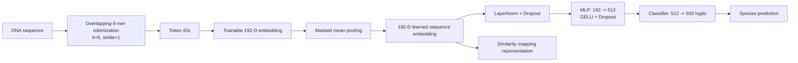
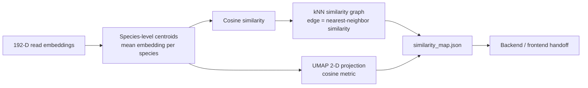

# K-mer Embedding Classifier Architecture

Short presentation view of the finalized eDNA taxonomic classifier and its similarity-map output.

## 1. Final 6-mer DL Classifier

The classifier learns a compact 192-D sequence representation from overlapping 6-mers. That same 192-D learned embedding is reused by the similarity-mapping stage.

## 2. Similarity Mapping

The similarity map is not another classifier. It converts learned embeddings into species-level points, local similarity edges, and 2-D coordinates for visualization.

## Key Final Facts

- Overlapping 6-mers (`k=6`, `stride=1`)
- 192-D learned embedding
- 500 species/classes
- Classification head: `192 -> 512 -> 500`
- Similarity mapping uses the learned 192-D representation

